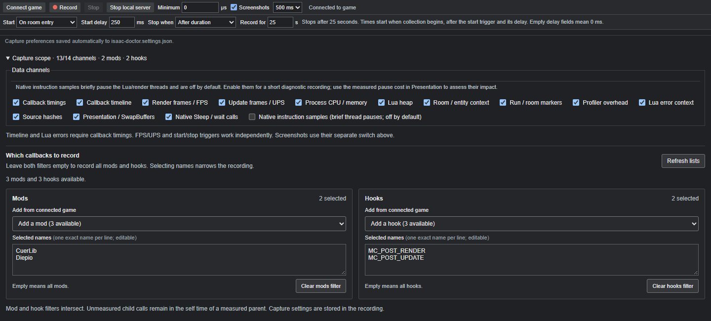

<p align="center">
  
</p>

<h1 align="center">Isaac Doctor</h1>

<p align="center">
  <strong>Find the mod callbacks behind slow frames.</strong><br>
  A local performance profiler for The Binding of Isaac: Repentance+ with REPENTOGON.
</p>

<p align="center">
  <a href="https://github.com/ShiroTsuma/Isaac-Doctor/releases"></a>
  <a href="LICENSE"></a>
  
</p>

<p align="center">
  <a href="#quick-start">Quick start</a> ·
  <a href="#explore-a-recording">Screenshots</a> ·
  <a href="#configure-your-capture">Capture scope</a> ·
  <a href="#a-real-fix-diepios-hud">A real fix</a> ·
  <a href="docs/README.md">Documentation</a>
</p>


*A real 90-second recording. Add graphs with **+**, choose their channels, and inspect the same time range across the timeline and analysis views.*

Select a slow frame, expand **mod → hook → function**, and read the Lua source beside its timings. Isaac Doctor gives mod authors a Chrome DevTools-style performance workflow: a zoomable timeline, independent graphs, screenshot filmstrip and resizable analysis drawer.

| Find | Investigate |
| --- | --- |
| Expensive callbacks | Calls, self/inclusive time, mean/max duration and nested callback trees |
| Frame spikes | Render/update intervals, FPS/UPS, rolling percentiles and sortable slow-frame breakdowns |
| Room-dependent costs | Entity, effect and projectile counts, room context, run markers and screenshots |
| The code responsible | Local Lua fragments, line numbers and recorded file-hash comparison |
| Changes after a fix | Compare recordings by mod, hook or callback, including cost per call and call rate |
| Large traces | Binary streaming, indexed range reads, Web Workers and reusable analysis in the original file |

StageAPI's custom callbacks are measured under their owning mod and `StageAPI:HOOK_NAME`. Expanding the parent callback reveals these nested calls, so a costly StageAPI dispatch can be traced to the mod function it invokes. Existing callbacks and later registrations are covered; the mods-loaded notification also handles StageAPI loading after attachment.

## Quick start

**Requires:** Windows x64, Repentance+ with [REPENTOGON](https://github.com/TeamREPENTOGON/REPENTOGON), and Chrome or Edge. The portable package includes the runtime and native tools.

1. Open [**Releases**](https://github.com/ShiroTsuma/Isaac-Doctor/releases) and download `IsaacDoctor-VERSION-windows-x64.zip` when an asset is available.
2. **Extract the entire ZIP** to a writable folder and double-click **IsaacDoctor.exe**. Keep its launcher window open; the profiler opens in your browser.
3. Start Isaac through **REPENTOGONLauncher**, using your usual Steam launch configuration, then click **Connect game**.
4. Choose **Connect captures folder** and select the extracted package's `bin/captures` folder. This lets the viewer refresh and open completed recordings automatically.
5. Choose your recording conditions, click **Record**, and reproduce the slowdown. The default collects 25 seconds after a loaded-run update.

No Python, Node.js, Visual Studio or build step is needed for the portable release. To build the project yourself, follow [Building and testing](docs/BUILDING.md).

> [!IMPORTANT]
> Start the game through **REPENTOGONLauncher**. Keep your existing launcher configuration for save compatibility. The profiler attaches to the running game and does not launch Isaac.

You can also open or drag in a `.isaacprof` recording. **Connect captures folder** remembers a live handle; your browser may ask you to grant access again after restarting. File-input and folder-input selections provide a snapshot of the chosen files.

<details>
<summary><strong>Stopping, restarting and updating</strong></summary>

**Stop local server**, closing the launcher window, or pressing Ctrl+C stops an active recording and closes the controller. Loaded analysis remains available in the browser, with game controls disabled. Double-click **IsaacDoctor.exe** again and use the newly opened page, or reload the previous tab once the launcher is running.

Closing the browser tab alone leaves the controller running. The game stays open, and the injected DLL stays loaded until the game exits. Restart through the game launcher before switching profiler versions. Recordings can be large, so leave free disk space in the extracted folder.

</details>

## Explore a recording

### Pick a slow frame

Open **Frames**, choose Render or Update, and sort by wall time. Inspect the retained callback breakdown or select the costliest callback. For a selection shorter than one complete interval, use **Show enclosing frame**.


### Put a spike in context

Add entity and effect graphs beside FPS. Select the section where cadence drops and inspect the filmstrip; hover a thumbnail for a larger image. Separate a busy room from a transition or recurring render work.


### Follow the call tree

Zoom into individual hooks and nested calls, then rank a selected range in **Bottom-up**. Expand a mod to inspect its hooks and functions. Each graph has its own channel choice; all graphs share navigation and the selected time range. Use **Min call**, next to **Range**, to focus on callbacks above a chosen duration in µs or ms. Shorter calls collapse into a single group with their count and summed self/total time in the callback tables. This changes the view, keeps the recording intact, and leaves FPS/frame statistics unchanged.

In **Frames**, open **Slow-frame patterns** to find callback costs that repeatedly increase during slow intervals. Click an interval for **Why was this interval slow?**: extra callback self and unattributed wall time, compared with up to five nearby intervals with similar update activity and recorded room/entity state. References and coverage are shown so a correlation does not become a false diagnosis.


## Configure your capture

Choose **when to start**, **when to stop**, and an independent delay in milliseconds for each. Conditions include a loaded run, room/level entry, projectile/tear/effect/NPC spawn, damage, run end and game exit. You can also start immediately, stop after a duration, or stop manually. The dropdowns show which conditions the connected game exposes.

| Stop mode | When collection ends |
| --- | --- |
| **After duration** | After the number of seconds set in **Record for**, beside **Stop when**. |
| **On an event** | After the matching event plus its stop delay. Enable **Maximum duration** to stop even if the event never happens. Whichever happens first wins. |
| **Manual stop** | When you click **Stop**. There is no implicit 25-second limit. You can enable **Maximum duration** as a separate safety limit. |

Times count from the beginning of collection, after the start condition and start delay. The maximum duration ends collection without an additional stop delay. Empty delay fields mean **0 ms**; the manual mode hides its unused stop delay. For example, **On room entry**, a **500 ms** stop delay and a **25 s maximum** ends 500 ms after the next room entry, or after 25 seconds if that condition has not ended the recording yet.



*Record Diepio and CuerLib render/update callbacks for **25 seconds**, starting **250 ms after room entry**. Expand **Capture scope** to select the channels, mods and hooks.*

- **Channels:** select callback timings, render/update frames, counters, memory, context, markers, errors and other available data. Screenshots have a separate switch.
- **Mods and hooks:** names load after **Connect game**. Use **Refresh lists** to read them again, select names from the dropdowns, or enter exact names one per line. Empty filters mean all; populated mod and hook filters must both match. Hooks also accept numeric IDs.
- **Capture minimum duration:** uses microseconds, so `1000 µs = 1 ms`. Short selected calls stay in aggregate timings but leave the saved timeline. Mod/hook filters and disabling callback timings bypass measurement for excluded calls.

The recording stores its capture settings. Triggers still work when their data channels are disabled. Repeated matching events do not reset a pending delay; **Stop** remains immediate. Canceling before collection begins creates no recording.

<details>
<summary><strong>Record from a script when running from source</strong></summary>

With the game already running through its launcher:

```powershell
# Default: 25 seconds after a loaded-run update.
.\record-game.ps1

# Start one second after room entry; collect for 60 seconds.
.\record-game.ps1 -Seconds 60 -StartOn room-entry -StartDelayMs 1000

# Start on a projectile; stop 750 ms after the next room entry.
.\record-game.ps1 -StartOn projectile -StopOn room-entry -StopDelayMs 750
```

Source builds save recordings in `build/Release/captures`; portable releases use `bin/captures`. Filenames include the UTC request/arming time; an event trigger can begin collecting later.

```text
capture-2026-10-11_19-12-48-713Z-pid36824-26943828.isaacprof
```

</details>

## A real fix: Diepio's HUD

In our recordings, Diepio performed HUD work on each render. We expanded **Bottom-up → Mods → Diepio**, followed three expensive render callbacks, and opened their local Lua source in **Summary → Source context**.


The HUD paths recreated fonts and repeated asset loading during renders. We cached three font instances and a reusable HUD sprite, preserving their drawing conditions. After restarting through the launcher, we recorded again and compared mean self time per call.

| Callback | Before | After |
| --- | ---: | ---: |
| `onRenderdrop` | 0.1888 ms | 0.0240 ms |
| `onRenderdropagain` | 0.0897 ms | 0.0003 ms |
| `RenderHeadcount` | 0.1985 ms | 0.0063 ms |
| **Combined mean self time per call** | **0.4770 ms** | **0.0306 ms** |

These callbacks used about **94% less measured self time**. The captures came from different runs, so this is an observed function-level improvement rather than a controlled FPS benchmark. Whole-session mean FPS remained near 58; other callbacks and engine work still matter.

To try this workflow on your mod, connect its local folder when opening **Source context**, compare the recorded hashes against your files, and make another capture after the change.

## Headless analysis

The CLI shares the viewer's TypeScript analysis code. Query recordings from disk without opening the browser or running the game. The full CLI requires the source checkout and Node.js; the portable package includes an aggregate-only native reader.

```powershell
.\isaacprof-cli.cmd --describe
.\isaacprof-cli.cmd list build/Release/captures --non-interactive
.\isaacprof-cli.cmd diagnose recording.isaacprof --top 10 --non-interactive
.\isaacprof-cli.cmd frames recording.isaacprof --clock render --top 10 --non-interactive
```

Use `serve` for persistent JSONL queries and shared caches. `prepare --write` stores reusable binary analysis in the original recording. `--non-interactive` suppresses progress output for automation. See the [CLI reference](docs/CLI.md) for commands, filters and source queries.

## Local by design

Your recordings and Lua sources stay on your machine. The browser reads files through local inputs or permissioned folder handles, and Web Workers process the capture bytes. A loopback controller handles game commands. The application does not upload recordings; a browser dialog labeled “Upload” still selects local files here.

The native DLL measures registered callbacks in C++ and streams events to an x64 collector. The collector writes indexed binary `.isaacprof` files. The viewer reads the blocks needed for a selected range and can save prepared analysis in the same file.

<details>
<summary><strong>Understand the measurements</strong></summary>

- **Inclusive time** includes nested instrumented callbacks; **self time** subtracts them. Both measure wall time, including native game APIs and waiting.
- **FPS/UPS** measure cadence between native render/update observations, rather than GPU time or display presentation. Duration p95/p99 describe slow intervals; FPS graphs use reciprocal rates and show the rolling sample population.
- **Scope affects attribution.** Excluded child work remains in the measured parent's self time. Coroutine callbacks are omitted because yield/resume wall time would misrepresent execution cost.
- **Context uses samples.** Room/entity counters need not match each frame exactly. Process memory and Lua-VM heap are not per-mod allocation measurements.
- **Coverage is explicit.** Duration-filtered calls stay in selected aggregates; timeline detail, dropped events, discarded calls and interrupted captures have separate coverage information.
- **Overhead measurements are partial.** Wrapper estimates and observer timings omit parts of collection, screenshots and timing-probe effects. Use independent cadence measurements and repeated matched A/B runs to estimate total impact.
- **Source hashes describe disk files at capture time.** A match does not prove the game loaded identical bytecode earlier.

If you share a recording, inspect its file paths, mod names, error stacks and screenshots first.

</details>

## Documentation and development

| Guide | Contents |
| --- | --- |
| [Building and testing](docs/BUILDING.md) | Source setup, development server, checks and portable release packaging |
| [CLI reference](docs/CLI.md) | Commands, structured output, automation and investigation examples |
| [Function scopes](docs/FUNCTION-SCOPES.md) | Optional native measurements of helpers inside mod callbacks |
| [Architecture](docs/ARCHITECTURE.md) | Native instrumentation, collector, controller and viewer |
| [Streaming format](docs/STREAMING.md) | Binary blocks, index, integrity and prepared analysis |
| [Roadmap](docs/ROADMAP.md) | Implemented features and planned work |

The project is under active development. Compatibility testing, matched A/B captures and deeper engine/GC attribution remain areas for improvement. When reporting a problem in [Issues](https://github.com/ShiroTsuma/Isaac-Doctor/issues), include the release version, game/REPENTOGON versions, selected capture scope and steps to reproduce it.

## Acknowledgements and license

Isaac Doctor targets [REPENTOGON](https://github.com/TeamREPENTOGON/REPENTOGON)'s game extension and Lua API and uses [MinHook](https://github.com/TsudaKageyu/minhook) for native hooking. The viewer workflow draws inspiration from Chrome DevTools Performance, [Perfetto](https://github.com/google/perfetto) and [speedscope](https://github.com/jlfwong/speedscope). [Mod Profiler](https://steamcommunity.com/sharedfiles/filedetails/?id=2505060515) provides an existing in-game workflow for Isaac modders and informed the feature baseline.

Project code uses the [MIT license](LICENSE); dependencies retain their licenses in [third-party notices](THIRD_PARTY_NOTICES.md). Game assets and third-party mods shown in examples belong to their authors. Isaac Doctor is an independent community project with no affiliation with the game's developers or the projects above.
