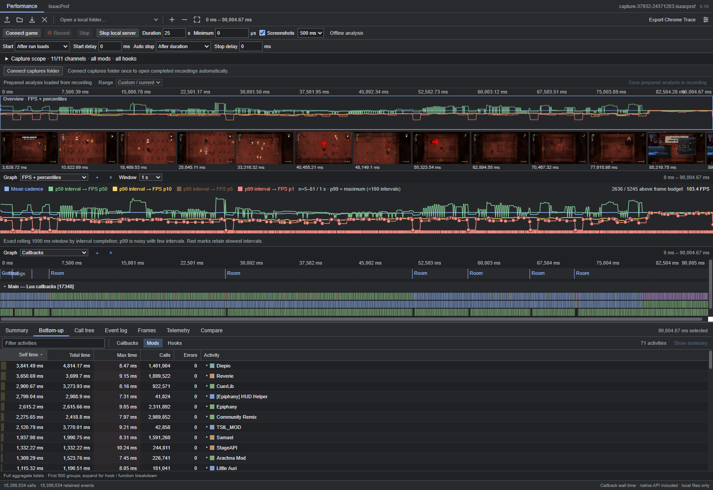
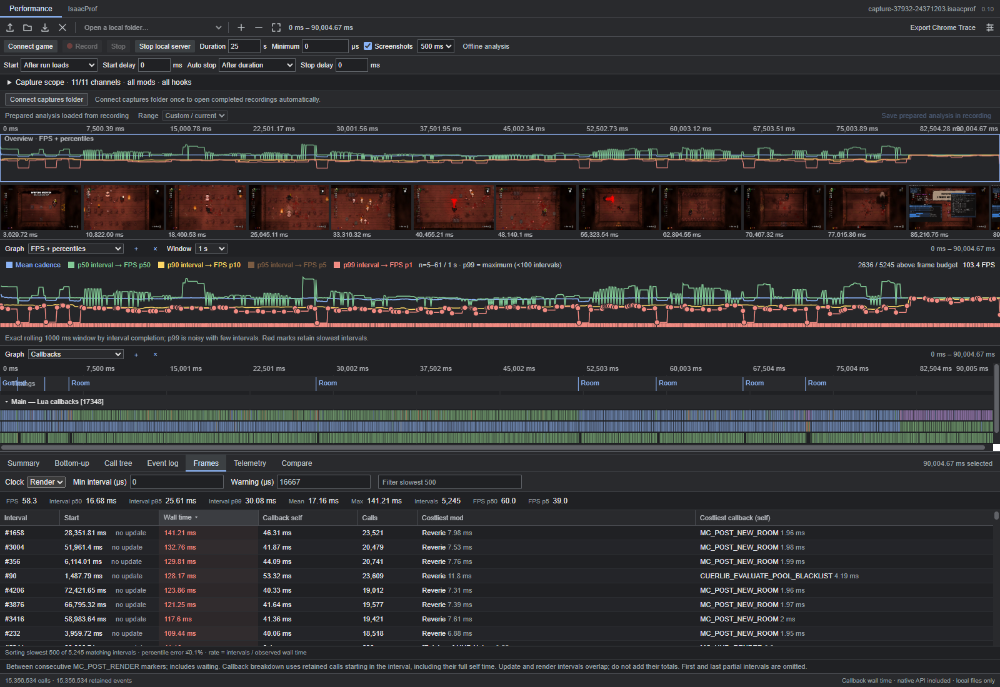
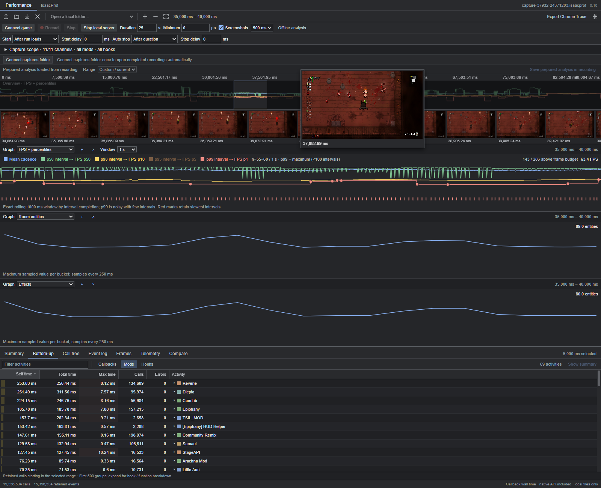
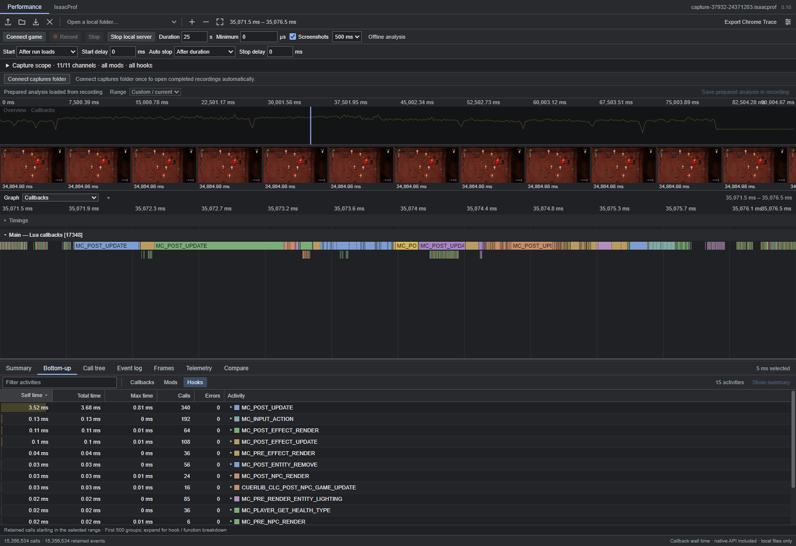
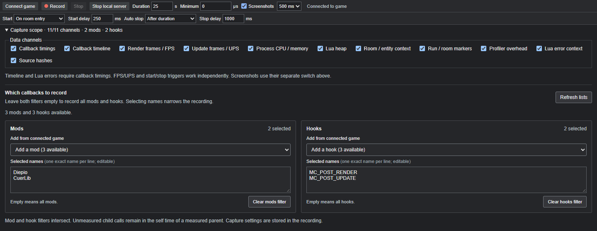
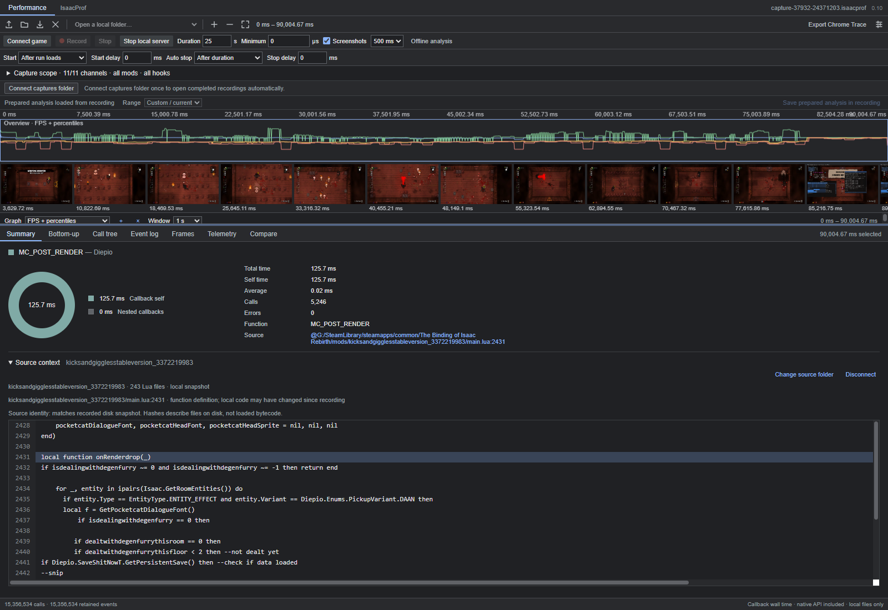
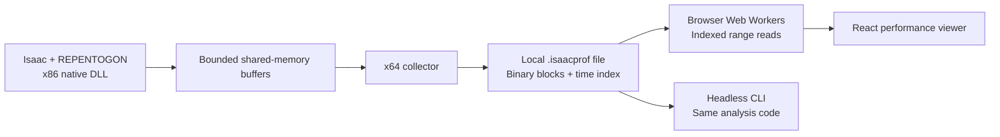

# Isaac Doctor

**Find the callbacks behind slow frames in The Binding of Isaac: Repentance+.**

Isaac Doctor records mod callback timings, frame cadence and game context, then lets you inspect them in a local browser. Start with a frame spike, expand the responsible mod and hook, and open the Lua function beside its timing.

The interface follows the workflow of Chrome DevTools' Performance panel: a navigable timeline, configurable graphs, screenshot filmstrip and a resizable analysis drawer. A headless CLI exposes the same analysis for scripts and automation.

> **Development status:** working profiler, under active development. Windows + Repentance+ + REPENTOGON. The executable names and scripts currently use `isaacprof`.

[Getting started](#getting-started) | [Features](#features) | [A real example](#a-real-example-diepios-hud) | [CLI](#headless-analysis) | [Measurement details](#reading-the-numbers) | [Roadmap](#roadmap)



*Actual game recording, with separate FPS and callback graphs. Use the + button to add a graph and choose its channel.*

## Why use it?

A low FPS counter tells you the game slowed down. To fix a mod, you need to know which callback ran, how often it ran, how much time it took and what was happening in the room.

Use Isaac Doctor to:

- Find expensive mods, then expand **mod > hook > function** instead of guessing from the installed mod list.
- Separate a rare room-entry stall from work that repeats on every update or render.
- Inspect slow frame intervals alongside entity counts, effects, projectiles and recorded screenshots.
- Read the actual Lua fragment for a selected callback and check its file hash against the recording.
- Compare recordings after a change, including per-call cost and call rate.
- Query a large recording from the CLI without opening the browser.

## Features

| Area | What you can inspect |
| --- | --- |
| Callback profiling | Calls, errors, inclusive time, self time, mean and maximum duration; parent/child spans |
| Timeline | Zoom, pan, range selection, call tree, sortable event log and screenshot filmstrip |
| Rankings | Bottom-up views grouped by mod, hook or callback; expandable breakdowns |
| Frames | Separate render and update intervals, FPS/UPS, duration percentiles and the slowest intervals |
| Graphs | Callbacks, frame duration, FPS/UPS and rolling percentiles, callback counts/self time, Lua-thread CPU, heap and entity counts |
| Game context | Run/room/level/end/exit markers; sampled room dimensions and entity/effect/projectile counts |
| Memory and CPU | Process working set/private bytes, page faults, process and Lua-thread CPU counters, VM-wide Lua heap |
| Source context | Local Lua fragments with line numbers, function definition and recorded disk hash comparison |
| Recording | Browser or script control; selectable start/stop conditions and separate millisecond delays |
| Capture scope | Independent data channels and exact mod/hook filters; settings stored inside the binary recording |
| Large recordings | Indexed range reads, bounded caches, Web Workers and prepared analysis saved in the same file |
| Automation | Structured CLI output, persistent JSONL sessions and a quiet `--non-interactive` mode |

### Inspect the slow intervals

Choose **Frames**, select Render or Update, and sort by wall time. Open an interval to inspect its retained callback breakdown, or select its costliest callback to see the source context. A selection shorter than one complete interval offers **Show enclosing frame**.



### See what changed in the room

Add entity and effect graphs beside FPS, then select the section where cadence drops. Use the filmstrip to see the room at that point; hover a thumbnail for a larger image. This helps you investigate an effect-heavy room separately from a transition or a recurring render callback.



### Follow the calls

Zoom into a few frames to read individual hooks and nested callbacks. Select a range to rank its retained calls, or click a callback to inspect its duration and source. All graphs share the selected time range; each graph has its own channel choice.



## Getting started

### Download and run (portable release)

Open this repository's **Releases** page and download `IsaacDoctor-VERSION-windows-x64.zip` when a release is available. **Extract the whole archive**, then double-click **IsaacDoctor.exe**. It opens a visible launcher window, starts the local controller and opens the profiler in your browser. Keep the launcher window open while recording. No Python, Node.js, Visual Studio or compilation is needed.

Start Isaac separately through **REPENTOGONLauncher**, then choose **Connect game** and **Record** in the profiler. Connect the captures folder to `IsaacDoctor/bin/captures` to open completed recordings automatically. Use a writable location with enough free disk space.

The release requires Windows x64, Repentance+ with REPENTOGON, and Chrome or Edge. The x86 game instrumentation and x64 collector are both included.

**Stop local server**, closing the launcher window, or pressing Ctrl+C stops an active recording and closes the controller. The loaded analysis remains in the browser; game controls are disabled after shutdown. To reconnect, double-click **IsaacDoctor.exe** again and use the newly opened page, or reload the previous tab once the launcher is running. Closing a browser tab alone does not close the controller. The game stays running; the injected DLL stays resident until the game exits. Restart the game through its launcher before switching profiler versions.

### Building from source: requirements

- **Windows 64-bit**, with **The Binding of Isaac: Repentance+** and **REPENTOGON**. The game-facing DLL and injector are x86; the collector runs as x64.
- **Visual Studio 2022 C++ tools**, including x86/x64 targets, Windows SDK and CMake.
- **Node.js 26 x64** and **pnpm**. The package manifest pins the package manager version.
- **Python 3** for the local recording controller. Offline CLI analysis does not need Python.
- **Chrome or Edge** for persistent folder access and saving prepared analysis into the original recording.

### Build

From the repository root:

```powershell
.\build.ps1
pnpm --dir viewer install --frozen-lockfile
pnpm --dir viewer build
```

The native build produces these files in `build/Release`:

| File | Purpose |
| --- | --- |
| `isaacprof.dll` | Native callback instrumentation inside the game |
| `isaacprof-injector.exe` | Attach, status, record, stop and callback catalog commands |
| `isaacprof-collector.exe` | x64 process that writes the binary recording |
| `isaacprof-analyze.exe` | Small native aggregate-report reader |

Keep the DLL and collector together in this output directory. The injector loads the DLL from there. CMake fetches pinned MinHook and REPENTOGON Lua dependencies on the first build.

### Record from the browser

1. Start Isaac **through REPENTOGONLauncher**, using your working Steam launch configuration. The profiler attaches to the running game; it does not launch Isaac.
2. Run `.\open-profiler.ps1` and open the local viewer.
3. Click **Connect game**. Wait until the game API is ready.
4. Click **Connect captures folder** and select `build/Release/captures`. Grant write access if you want to save prepared analysis into the original files.
5. Choose the recording conditions and capture scope, then click **Record**. The default records 25 seconds after the next loaded-run update.
6. Play through the situation you want to investigate. The viewer shows collecting/saving/loading progress and opens the completed recording through the connected folder handle.

**Launch Isaac through REPENTOGONLauncher.** Keep the launcher configuration you already use for your saves; do not start `isaac-ng.exe` directly for profiling.

You can also open a `.isaacprof` file, drag it onto the viewer, or use the folder-input fallback. Those choices give a snapshot of the selected files. **Connect captures folder** remembers a live handle and refreshes its listing; the browser may ask you to reconnect permission after a restart.

### Record with a script

With the game already running:

```powershell
# Default: 25 seconds after a loaded-run update.
.\record-game.ps1

# Start one second after entering a room; collect for 60 seconds.
.\record-game.ps1 -Seconds 60 -StartOn room-entry -StartDelayMs 1000

# Start on a projectile and stop 750 ms after the next room entry.
.\record-game.ps1 -StartOn projectile -StopOn room-entry -StopDelayMs 750
```

Available event conditions include loaded-run updates, room/level entry, projectile/tear/effect/NPC spawn, damage, run end and game exit. Start also supports **Immediately**; stop also supports **After duration** and **Manual stop only**. The dropdowns show which events the connected game exposes.

Each delay uses **milliseconds**. Repeated matching events do not reset a pending delay. **Stop** remains immediate, regardless of the configured automatic stop delay. If you cancel before recording begins, the profiler creates no capture file.

Recordings go to `build/Release/captures`, with the UTC request timestamp in the filename:

```text
capture-2026-10-11_19-12-48-713Z-pid36824-26943828.isaacprof
```

The timestamp describes the request/arming time. A delayed event trigger can begin collecting later.

### Choose the capture scope

Expand **Capture scope** to enable the channels you need. For a cadence-only recording, keep Render frames / FPS and Update frames / UPS, and switch off callback timings and the other channels. For a focused investigation, keep callback timings and select exact mod/hook names from the dropdowns. Available names load automatically after **Connect game**; **Refresh lists** reads them again. Loading, empty catalogs and failures are shown beside that button, with retry available.



*Example configuration: record Diepio and CuerLib update/render callbacks, start on room entry after 250 ms, and stop after the configured duration plus a 1,000 ms delay. Names can also be entered manually.*

Empty mod or hook filters mean **all**. When both filters contain entries, a callback must match both. You can also enter names one per line; hooks accept their name or numeric ID. Triggers continue to work when their data channels are disabled.

The timeline and Lua error context require callback timings. Screenshots have their own switch. Minimum callback duration uses **microseconds**: `1000 µs = 1 ms`. It filters saved timeline events while keeping aggregate timings for the selected callbacks. Short selected calls still incur timing overhead; the mod/hook filters and callback channel switch bypass their measurement.

Capture settings travel with the recording, so a reader can distinguish an intentionally disabled channel from unavailable data.

## A real example: Diepio's HUD

In our recordings, Diepio performed HUD work on each render. Three callbacks stood out: `onRenderdrop`, `onRenderdropagain` and `RenderHeadcount`.

We used this workflow:

1. Open the recording and select **Bottom-up → Mods**. Expand Diepio's render hook to see the individual functions.
2. Switch to **Callbacks** and select the relevant `main.lua` function. Open **Summary → Source context**, then connect the local Diepio mod folder.
3. Read the function beside its timings. The HUD paths recreated fonts and repeated asset loading during renders. We cached three font instances and the reusable HUD sprite, preserving the conditions for drawing them.
4. Restart through the launcher, record again, and compare the same functions using mean self time per call. Check the recorded source hashes against the patched files.



| Callback | Before: mean self per call | After: mean self per call |
| --- | ---: | ---: |
| `onRenderdrop` | 0.1888 ms | 0.0240 ms |
| `onRenderdropagain` | 0.0897 ms | 0.0003 ms |
| `RenderHeadcount` | 0.1985 ms | 0.0063 ms |
| **Combined** | **0.4770 ms** | **0.0306 ms** |

That is about **94% less measured self time** across these three HUD callbacks. The recordings came from different runs, so this is an observed function-level improvement, not a controlled FPS benchmark. Whole-session mean FPS stayed near 58 in both recordings; other callbacks and engine work still matter.

Room context also helped choose the next investigation. In the newer recording, CuerLib's grid-update callback averaged about **0.310 ms** in smaller-room intervals and **0.826 ms** in larger-room intervals. The source scans room grid cells, which makes room-size scaling a useful lead. Those cohorts are sampled observational data; verify a proposed fix with matched rooms and repeated recordings.

## Headless analysis

The CLI shares the browser's TypeScript analysis implementation and reads recordings from disk. It does not need the local web server or a running game.

```powershell
.\isaacprof-cli.cmd --describe
.\isaacprof-cli.cmd list build/Release/captures --non-interactive

# Replace recording.isaacprof with a path from the listing.
.\isaacprof-cli.cmd report recording.isaacprof --top 10 --non-interactive
.\isaacprof-cli.cmd diagnose recording.isaacprof --top 10 --non-interactive
.\isaacprof-cli.cmd frames recording.isaacprof --clock render --top 10 --non-interactive

# Inspect a slow section, then the source of a discovered metric.
.\isaacprof-cli.cmd rank recording.isaacprof --start-ms 35000 --end-ms 40000 --group mods --non-interactive
.\isaacprof-cli.cmd source recording.isaacprof --metric 454 --mods "path\to\mods" --non-interactive
```

Discover metric IDs from the recording; the IDs and sample time range above are examples. `diagnose` compares typical/slow intervals, update activity, time windows and sampled room/entity cohorts. `--non-interactive` suppresses progress output for machine use. Human-facing processing progress goes to stderr.

Use `serve` for persistent JSONL queries with a shared index/cache. `prepare --write` stores reusable binary analysis in the original recording. See [CLI reference](docs/CLI.md) for schemas, filters, source matching, limits and examples.

## How it works



The DLL installs native C wrappers around registered mod callbacks and uses `QueryPerformanceCounter` for timings. Lua bootstrap code connects the wrappers to the game's callback registration API. The timing path runs in C++; it uses the Lua library already loaded by REPENTOGON.

Game callbacks publish to bounded shared-memory buffers. The collector writes versioned binary blocks with CRCs, time ranges and an index. Buffer capacity limits pending events, not the total recording length. Overflow and missing data remain explicit.

The viewer reads selected blocks with `File.slice()` inside Web Workers. It keeps bounded caches and uses timeline previews for wide ranges. Prepared statistics for the session, halves and quarters live in a versioned section of the same recording; the viewer still queries arbitrary ranges and exact retained calls.

### Local files and privacy

Recordings and Lua sources stay on your machine. The browser reads them through file inputs or permissioned file handles; the application does not upload them. A loopback Python controller handles recording commands, while workers process capture bytes in the browser. If a browser labels its folder-input dialog "Upload", that dialog still selects local files for this application.

You can share a recording yourself. Captures can include file paths, mod names, error stacks, source hashes and game screenshots, so inspect those details before publishing a trace.

## Reading the numbers

- **Inclusive time** covers a callback and its nested instrumented callbacks. **Self time** subtracts those nested timings. Both measure wall time, including native game APIs and waiting.
- **FPS/UPS** describe the cadence between native render/update observations. They do not measure GPU execution or display presentation. Duration percentiles describe slow intervals; higher p95/p99 means longer intervals. FPS graphs use reciprocal rates and show the sample population for their rolling window.
- **Selected scope** changes attribution. Work in excluded child callbacks stays in the self time of a measured parent. Coroutine callbacks are deliberately omitted because yield/resume wall time would misrepresent execution cost.
- **Room and entity context** uses samples rather than exact counts for each frame. Process and Lua-VM memory are not per-mod allocation measurements.
- **Filtered calls** remain in selected callback aggregates but disappear from timeline/range detail. Dropped events, discarded calls and interrupted captures have separate coverage information.
- **Profiler overhead** includes a sampled wrapper estimate and observer timing. It excludes parts of collection, screenshots and timing-probe effects. Use an independent cadence measurement and repeated matched A/B runs to estimate total impact.
- **Source hashes** describe files on disk at capture time. A matching hash does not prove the game loaded identical bytecode earlier.

## Development

```powershell
pnpm --dir viewer dev
```

This starts Vite with its managed local Python controller. Ending that Vite process stops/finalizes active recording and closes its controller. `.\open-profiler.ps1` starts a separate built viewer; use **Stop local server** to stop recording and close that controller. In development this leaves Vite serving the analysis UI; it does not close Vite.

`pnpm --dir viewer build` runs strict TypeScript checks and ESLint with zero warnings before building. Native targets use compiler warnings as errors.

Controlled capture tests use owned Lua host processes rather than launching Isaac:

```powershell
.\build.ps1 -BuildDirectory build/stream-dev
python tests/capture-triggers.py
python tests/stream-smoke.py
python tests/controller-server.py
node --experimental-strip-types --test tests/diagnosis.test.cjs tests/cli.test.cjs tests/debugging.test.cjs tests/frames.test.cjs tests/worker-client.test.cjs tests/recording-files.test.cjs
```

Browser regression scripts in `tests/` exercise graph navigation, sorting, folder refresh and recording lifecycle against the built local viewer. See [streaming format](docs/STREAMING.md), [binary format](docs/FORMAT.md) and [project roadmap](docs/ROADMAP.md) for implementation details.

### Creating a release

```powershell
.\package-release.ps1
```

This builds the native targets and viewer, bundles a Python runtime into `IsaacDoctor.exe`, and writes a portable ZIP and SHA-256 checksum under `build/releases`. `-SkipBuild` packages existing outputs. Upload the ZIP and checksum as GitHub Release assets; do not commit build outputs. The package includes dependency notices and excludes test hosts, game binaries, mods and private captures. Test the extracted archive with `python tests/release-smoke.py PATH_TO_ZIP` after generating the controlled host in `build/stream-dev`. This checks startup without external runtimes, local UI serving, recording and shutdown against the owned host; game compatibility still needs a launcher-based real-game session.

## Roadmap

- [x] Native callback timing and aggregate rankings.
- [x] Binary streaming, x64 collection, indexed reads and explicit loss reporting.
- [x] Browser timeline, frame inspection, configurable graphs and local source context.
- [x] FPS/UPS, percentiles, sampled room/entity context, process/VM counters and error stacks.
- [x] Shared headless analysis with progress and non-interactive output.
- [x] Triggered start/stop recording, independent delays and channel/mod/hook selection.
- [ ] Matched A/B capture workflow and independent profiler-overhead baselines.
- [ ] More engine/GC attribution and allocation diagnostics where instrumentation permits.
- [x] Portable Windows release packaging with bundled runtime and checksums.
- [ ] Broader compatibility checks and reproducible public demo recordings.

## Acknowledgements

[REPENTOGON](https://github.com/TeamREPENTOGON/REPENTOGON) supplies the game extension and Lua API this profiler targets. Native hooking uses [MinHook](https://github.com/TsudaKageyu/minhook).

The viewer workflow takes inspiration from Chrome DevTools Performance, [Perfetto](https://github.com/google/perfetto) and [speedscope](https://github.com/jlfwong/speedscope). [Mod Profiler](https://steamcommunity.com/sharedfiles/filedetails/?id=2505060515) provides an existing in-game profiling workflow for Isaac modders and informed the feature baseline.

Isaac Doctor is an independent community project and has no affiliation with the game's developers or those projects.

## License

Project code is available under the [MIT license](LICENSE). Dependencies retain their own licenses; see [third-party notices](THIRD_PARTY_NOTICES.md). Game assets and third-party mods shown in examples belong to their respective authors and are not licensed by this project.
