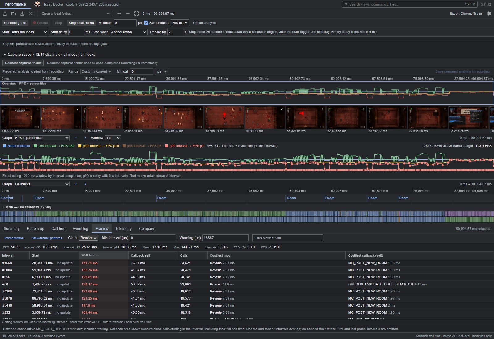
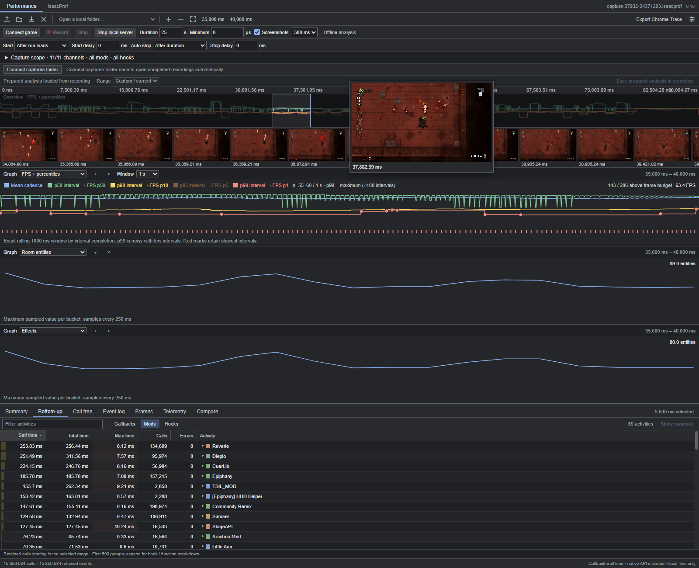
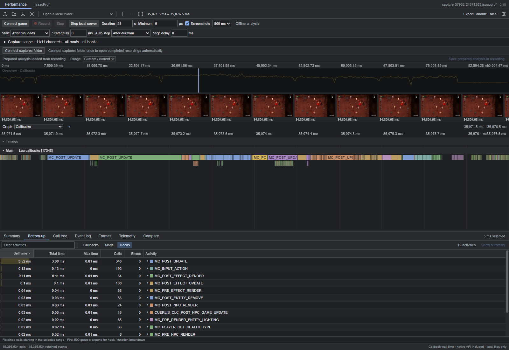
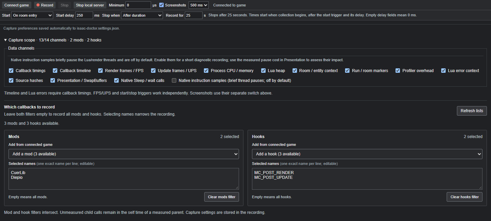

# Recording and analysis guide

[Back to the project README](../README.md)

## Explore a recording

Use **Ctrl+K** or the top search bar to jump to a view, mod, hook or source. Search `SwapBuffers` for presentation diagnostics; prefix a query with `>` for commands, `@` for mods/hooks, or `/` for recordings/sources.

### Pick a slow frame

Open **Frames**, choose Render or Update, and sort by wall time. Inspect the retained callback breakdown or select the costliest callback. For a selection shorter than one complete interval, use **Show enclosing frame**.

If a slow interval has little extra Lua work, choose **Frames → Presentation**. The independent **Presentation / SwapBuffers** capture channel measures time between swap returns, time inside `SwapBuffers`, and screenshot-hook cost. Add a presentation timing graph to compare spikes across the same range. These measurements help separate callback costs from delays elsewhere; they do not identify a GPU bottleneck or measure time on the display.

For unresolved native work, enable **Native instruction samples** for a short diagnostic recording. This channel is **off by default** because it briefly pauses the observed threads. **Frames → Presentation** shows module/RVA hotspots, snapshots inside covered waits and SwapBuffers, partial frame-pointer return candidates, and measured readback/resume pause cost. Snapshot counts include sleeping threads; they are not CPU or GPU percentages. Where the Lua memory layout passes runtime validation, the same view also attributes snapshots to existing wrapper owners and nearby Lua function definitions. Click a sampled source to open folded local source context, including when callback timings are disabled. Definition lines are not the currently executing line. The CLI exposes the same data with `samples CAPTURE.isaacprof --non-interactive`.

Enable **Native Sleep / wait calls** to inspect explicit Windows waits on the observed Lua and rendering threads. **Frames → Presentation** shows the six covered APIs, requested timeouts, observed wall durations and call sites as `module+offset`. Click a wait to select its exact span, or add the **Native Sleep / waits (ms)** graph alongside presentation timing. A 1 ms requested timeout can have a longer observed duration. Wait spans can overlap callbacks and `SwapBuffers`; do not add these times together.

Drag any table header's right edge to resize its column. Widths are remembered for that column layout, including Presentation, native waits, comparison and telemetry tables. Focus an edge and use arrow keys for keyboard resizing; double-click it to reset the table widths.

The presentation panel also records window size, OpenGL viewport, renderer and swap interval when available. Missing wait records do not rule out scheduling delays, other waiting APIs or GPU work. For a lightweight control recording, disable callback aggregates and timeline while retaining presentation, native waits, frame intervals, room context and process counters. Compare the same room after startup menus close.

The source CLI exposes the same analysis without opening the browser:

```powershell
pnpm --dir viewer analyze waits "path/to/capture.isaacprof" --start-ms 2500 --end-ms 6000 --top 20 --non-interactive
```



### Put a spike in context

Add entity and effect graphs beside FPS. Select the section where cadence drops and inspect the filmstrip; hover a thumbnail for a larger image. Separate a busy room from a transition or recurring render work.



### Follow the call tree

Zoom into individual hooks and nested calls, then rank a selected range in **Bottom-up**. Expand a mod to inspect its hooks and functions. Each graph has its own channel choice; all graphs share navigation and the selected time range. Use **Min call**, next to **Range**, to focus on callbacks above a chosen duration in µs or ms. Shorter calls collapse into a single group with their count and summed self/total time in the callback tables. This changes the view, keeps the recording intact, and leaves FPS/frame statistics unchanged.

In **Frames**, open **Slow-frame patterns** to find callback costs that repeatedly increase during slow intervals. Click an interval for **Why was this interval slow?**: extra callback self and unattributed wall time, compared with up to five nearby intervals with similar update activity and recorded room/entity state. References and coverage are shown so a correlation does not become a false diagnosis.

The view explains the observed difference and suggests a next measurement. It also detects alternating update/render pacing and flags when one interval dominates the average. **Inspect evidence** opens an example; **Open callback / source** follows the measured function. References can expose spikes, but a cost shared by slow and reference intervals needs an absolute-cost or measurement-mode comparison. Keep all mods enabled when comparing capture scopes.



## Configure your capture

Choose **when to start**, **when to stop**, and an independent delay in milliseconds for each. Conditions include a loaded run, room/level entry, projectile/tear/effect/NPC spawn, damage, run end and game exit. You can also start immediately, stop after a duration, or stop manually. The dropdowns show which conditions the connected game exposes.

| Stop mode | When collection ends |
| --- | --- |
| **After duration** | After the number of seconds set in **Record for**, beside **Stop when**. |
| **On an event** | After the matching event plus its stop delay. Enable **Maximum duration** to stop even if the event never happens. Whichever happens first wins. |
| **Manual stop** | When you click **Stop**. There is no implicit 25-second limit. You can enable **Maximum duration** as a separate safety limit. |

Times count from the beginning of collection, after the start condition and start delay. The maximum duration ends collection without an additional stop delay. Empty delay fields mean **0 ms**; the manual mode hides its unused stop delay. For example, **On room entry**, a **500 ms** stop delay and a **25 s maximum** ends 500 ms after the next room entry, or after 25 seconds if that condition has not ended the recording yet.



*Example configuration: record Diepio and CuerLib render/update callbacks for **25 seconds**, starting **250 ms after room entry**. Expand **Capture scope** to select the channels, mods and hooks.*

- **Channels:** select callback timings, render/update frames, counters, memory, context, markers, errors and other available data. Screenshots have a separate switch.
- **Mods and hooks:** names load after **Connect game**. Use **Refresh lists** to read them again, select names from the dropdowns, or enter exact names one per line. Empty filters mean all; populated mod and hook filters must both match. Hooks also accept numeric IDs.
- **Capture minimum duration:** uses microseconds, so `1000 µs = 1 ms`. Short selected calls stay in aggregate timings but leave the saved timeline. Mod/hook filters and disabling callback timings bypass measurement for excluded calls.

The recording stores its capture settings. Triggers still work when their data channels are disabled. Repeated matching events do not reset a pending delay; **Stop** remains immediate. Canceling before collection begins creates no recording.

<details>
<summary><strong>Record from a script when running from source</strong></summary>

With the game already running through its launcher:

```powershell
# Default: 25 seconds after a loaded-run update.
.\record-game.ps1

# Start one second after room entry; collect for 60 seconds.
.\record-game.ps1 -Seconds 60 -StartOn room-entry -StartDelayMs 1000

# Start on a projectile; stop 750 ms after the next room entry.
.\record-game.ps1 -StartOn projectile -StopOn room-entry -StopDelayMs 750
```

Source builds save recordings in `build/Release/captures`; portable releases use `bin/captures`. Filenames include the UTC request/arming time; an event trigger can begin collecting later.

```text
capture-YYYY-MM-DD_HH-MM-SS-mmmZ-pidPID-ID.isaacprof
```

</details>

